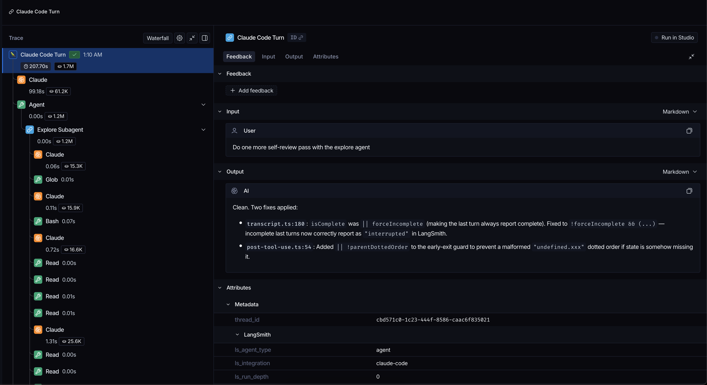

# LangSmith Tracing for Claude Code

Sends your Claude Code conversations to [LangSmith](https://smith.langchain.com) so you can see what the agent actually did.



## What you need

- **On a Mac:** nothing. The plugin carries its own build and runs it directly.
- **On Windows and Linux:** Node.js 20 or newer.
- A LangSmith account.

Node is still worth having on a Mac because the plugin falls back to it if its own build can't start.

## Install

### Install for yourself

Run these inside Claude Code:

```text
/plugin marketplace add langchain-ai/langsmith-claude-code-plugins
/plugin install langsmith-tracing@langsmith-claude-code-plugins
/reload-plugins
```

Auto-update is off for this marketplace by default. Turn it on in `/plugin` under **Marketplaces** or update by hand with `claude plugin update langsmith-tracing@langsmith-claude-code-plugins`. The new version loads in your next session.

Using Claude Cowork? See [Tracing Claude Cowork](./COWORK.md) to install the plugin there.

### Install for your organization

Admins can install the plugin for everyone through Claude Code's managed settings. See [Manage Claude Code plugins for your organization](https://code.claude.com/docs/en/plugins/org) for how, or [Choose a rollout route](https://claude.com/docs/plugins/org-rollout) to cover claude.ai and Cowork too. Then use the managed file below to switch tracing on and set the project for everyone.

### Lock settings with a managed file

An admin can lock any setting in the [Settings](#settings) table except `profile` with a managed file at `~/.langsmith-plugins/managed.json` in each user's home folder. It overrides every other file and environment variable and works on macOS and Linux. Admins usually install it on each machine with an MDM tool, which manages company laptops (such as Jamf, Kandji or Microsoft Intune).

The plugin only trusts the file when:

- Root owns the file and its folder
- No other user can write to either
- Neither is a symlink

If the file is broken or fails these checks then tracing stops and Claude Code explains why. See [the settings guide](https://github.com/langchain-ai/langsmith-plugin-binary/blob/main/docs/settings.md) to set it up.

## Authenticate

The simplest option is to sign in once with the LangSmith CLI, which you can [install from its docs](https://docs.langchain.com/langsmith/langsmith-cli#install) if you don't have it yet:

```bash
langsmith auth login
```

If you use the CLI sign-in and have more than one profile set `profile` to the one the plugin should use. Your own `api_key` ignores this setting, but a generic `LANGSMITH_API_KEY` isn't used as a fallback while `profile` is set.

You can use an API key instead by setting `api_key` in your config file. Create one at [smith.langchain.com](https://smith.langchain.com) under **Settings** then **API Keys**.

If more than one credential is set the plugin uses the first one it finds:

1. The plugin's own key from `api_key` or `CC_LANGSMITH_API_KEY`
2. Your `langsmith auth login` sign-in
3. A generic `LANGSMITH_API_KEY` in your shell

When your sign-in expires or your key is rejected the plugin stops uploading but still lets your prompts through. Turns from that gap never upload their content, and Claude Code shows a reminder in the chat at most every 2 minutes until you fix it. Use `notice_cooldown` to change that interval or set it to `off` to hide the reminders.

### Strict auth

Strict auth refuses every prompt until your sign-in or key works again, even if no credentials were ever set. Turn it on by setting `strict_auth` to `true`. It's off by default and has no effect while tracing is off.

> **Strict auth also blocks `claude -p`.** Leave it off in CI unless a failed sign-in should fail the job.

## Turn on tracing

Tracing is off until you switch it on in `~/.claude/langsmith.json`, unless your admin already turned it on with a [managed file](#lock-settings-with-a-managed-file). Send traces to an agent with `agent_id`:

```json
{ "enabled": true, "agent_id": "shared-claude" }
```

Or send them to a project with `project`:

```json
{ "enabled": true, "project": "shared-claude" }
```

Use either one, and `agent_id` wins if you set both. With neither set traces go to the `claude-code` project. Send a message and look for it in LangSmith.

A project can override these settings in `<project>/.claude/langsmith.json` and any setting in your shell beats the files. [Advanced configuration](./ADVANCED.md) lists every location.

> **Check a repository's tracing settings before you trust it.** A cloned repository can switch tracing on and send your conversations to someone else's server. Review its `.claude/langsmith.json` and `langsmith-plugins.json` along with `.claude/settings.json` and `.claude/settings.local.json`.

## What gets traced

Each model call includes the conversation so far and the reply along with the model name, provider and token counts. Tool calls include their inputs and outputs and skill calls record which skill ran. Subagents appear nested under the turn that started them.

A tool call that touches a file inside a git repo is tagged with the repository name, branch, commit and author. A subagent only uploads once it finishes, so cancelling one drops its steps. Run `/langsmith-tracing:trace` to get a link to the current conversation's trace.

## Hide a conversation

To keep one conversation's content out of LangSmith run these inside Claude Code:

```text
/langsmith-tracing:mute
/langsmith-tracing:unmute
```

The confirmation appears as a prompt blocked by a hook. That's how Claude Code shows a plugin's reply, so nothing went wrong and the command never reaches the model.

A muted conversation keeps its structure in LangSmith but leaves out what was said. Muting starts from your next turn so wait for the confirmation before you send anything sensitive. It only changes what reaches LangSmith and doesn't delete earlier uploads.

Set `defaultMuted` to `true` to mute every conversation by default. A conversation you mute or unmute by hand keeps that choice.

## When nothing shows up

- **No runs at all.** Check that the plugin is installed and enabled in `/plugin` and that tracing is on. A `TRACE_TO_LANGSMITH` in your shell overrides your config files.
- **Tracing is paused.** Your sign-in expired or your key was rejected. Run `langsmith auth login` again or replace the key and tracing resumes from the next prompt.
- **Runs in the wrong project.** Check `project` in your config file and `CC_LANGSMITH_PROJECT` in your shell.
- **Still stuck.** Set `CC_LANGSMITH_DEBUG=true` and check `~/.claude/state/hook.log`. The background uploader logs to `~/.claude/state/langsmith_engine/worker.log`.

## Privacy

With tracing on each turn uploads your messages, tool inputs and outputs, metadata, token usage and subagent structure. A muted turn uploads only the structure.

Secrets are stripped before upload unless you turn `redact` off. This covers API keys, JWTs, PEM blocks and common credential patterns in variables, headers and URLs. Redaction isn't a guarantee, so keep tracing off if none of this can leave your machine.

## Settings

Each setting has a config file key and an environment variable. The environment variable wins when both are set.

| Config key           | Environment variable           | Default                           | What it does                            |
| -------------------- | ------------------------------ | --------------------------------- | --------------------------------------- |
| `enabled`            | `TRACE_TO_LANGSMITH`           | `false`                           | Whether to trace at all                 |
| `api_key`            | `CC_LANGSMITH_API_KEY`         | none                              | Your LangSmith key                      |
| `project`            | `CC_LANGSMITH_PROJECT`         | `claude-code`                     | Where runs land                         |
| `agent_id`           | `LANGSMITH_AGENT_ID`           | none                              | Agent to trace to, instead of project   |
| `api_url`            | `LANGSMITH_ENDPOINT`           | `https://api.smith.langchain.com` | Which server to send to                 |
| `defaultMuted`       | `CC_LANGSMITH_DEFAULT_MUTED`   | `false`                           | Leave content out unless told otherwise |
| `redact`             | `CC_LANGSMITH_REDACT`          | `true`                            | Strip secrets before upload             |
| `redact_extra_rules` | `CC_LANGSMITH_REDACT_EXTRA`    | none                              | Extra patterns to strip                 |
| `metadata`           | `CC_LANGSMITH_METADATA`        | none                              | Custom fields on every run              |
| `replicas`           | `CC_LANGSMITH_RUNS_ENDPOINTS`  | none                              | Send the same trace somewhere else too  |
| `strict_auth`        | `CC_LANGSMITH_STRICT_AUTH`     | `false`                           | Refuse prompts until you sign in again  |
| `notice_cooldown`    | `CC_LANGSMITH_NOTICE_COOLDOWN` | `2`                               | Minutes between reminders, or `off`     |
| `profile`            | none                           | the CLI's current one             | Which CLI login to use                  |
| `workspace_id`       | none                           | the login's own                   | Workspace for a login's traces          |

`profile` is personal so the managed file can't lock it. `LANGSMITH_PROFILE` and `LANGSMITH_WORKSPACE_ID` are only used when no `profile` or `workspace_id` is set in a settings file.

## More

- [Running in CI, nesting under another run, sending to a second project and where settings can live](./ADVANCED.md)
- [Tracing Claude Cowork tasks](./COWORK.md)
- [The separate `langsmith-gateway` plugin](./GATEWAY.md), which routes model requests through LangSmith and is unrelated to tracing

## Development

```bash
pnpm install
pnpm test
pnpm build
```

Run `pnpm build` and then `claude --plugin-dir /path/to/langsmith-claude-code-plugins/plugins/langsmith-tracing`. Send a new message to pick up your changes.

## License

MIT
